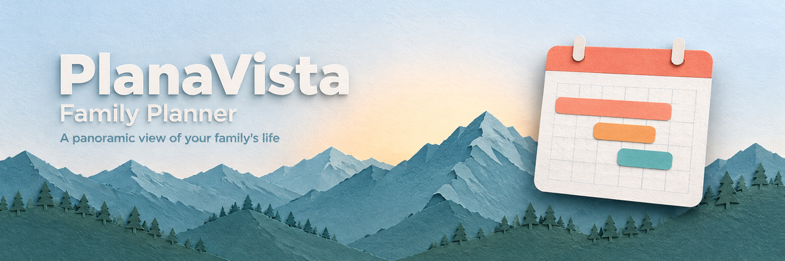
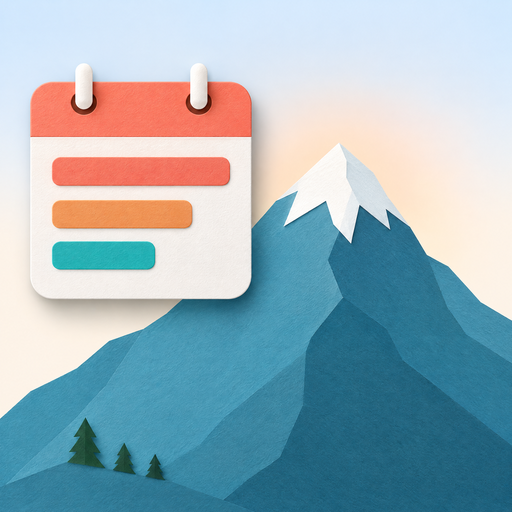

<p align="center">
  
</p>

<h1 align="center">PlanaVista</h1>

<p align="center">
  <strong>A panoramic view of your family's life</strong><br>
  A beautiful, privacy-first family calendar and chore board for Home Assistant that rivals Skylight and Hearth, with no monthly fees.
</p>

<p align="center">
  <a href="https://github.com/tavenhall1/planavista/releases"></a>
  <a href="https://github.com/tavenhall1/planavista/blob/main/LICENSE"></a>
  <a href="https://github.com/hacs/integration"></a>
</p>

---

## Features

- **4 Calendar Views**: Day (per-person columns), Week, Month, and Agenda
- **Chores**: One board for the whole family, with a ring for each person's day, stars, rewards, and a parent's approval when you want one
- **Start from Your Plan**: Import a Household Hours plan, pick from common chores, or start empty
- **Deep Google Calendar Integration**: Attendee invitations, in-place PATCH edits, real organizer detection via API
- **Shared Event Awareness**: Multi-participant detection, organizer badges, stripe gradients, participant avatars
- **Full Event Management**: Create, edit, and delete events with optional address suggestions and multi-calendar support
- **Past Event Dimming**: Finished events automatically fade so you can focus on what's next
- **20-Color Palette**: Earth, ocean, warm, and vivid tones for calendar personalization
- **Built-in Setup**: Auto-discovers your calendars, weather, and people entities
- **Day and Night**: Light, Dark, or Automatic (at sunset and sunrise, on a schedule, or with Home Assistant), with three themes that each have a light and a dark version
- **Animated Weather**: 15 custom SVG icons with condition-based gradients and forecasts
- **Per-Person Day View**: Skylight-inspired columns with large person avatars
- **Fits Any Screen**: The card lays itself out for its own size, with the controls along the bottom in portrait and on phones
- **Easy Install via HACS**: No YAML or code required, just point-and-click setup
- **Local by Default**: Your calendar data stays on your network; the only optional lookup is address suggestions, which is off until you turn it on

---

## Quick Start

### 1. Set Up Your Calendars

Make sure you have at least one calendar integration configured:

- **[Google Calendar](https://www.home-assistant.io/integrations/google/)**: Settings > Integrations > Google Calendar
- **Local Calendar**: Settings > Integrations > Local Calendar
- Any integration that creates `calendar.*` entities

### 2. Install PlanaVista

#### HACS (Recommended)

1. Open **HACS** in Home Assistant
2. Go to **Integrations** (not Frontend)
3. Click the **three-dot menu** (top right) and select **Custom repositories**
4. Add this repository URL:
   ```
   https://github.com/tavenhall1/planavista
   ```
5. Set category to **Integration** and click **Add**
6. Search for **PlanaVista** and click **Download**
7. **Restart Home Assistant**

#### Manual

1. Download the `custom_components/planavista` folder from this repository
2. Copy it into your Home Assistant `config/custom_components/` directory
3. Restart Home Assistant

### 3. Add the PlanaVista Integration

1. Go to **Settings > Devices & Services**
2. Click **Add Integration**
3. Search for **PlanaVista**
4. Follow the single-step setup (calendars are auto-discovered)

### 4. Open PlanaVista

Adding the integration puts **PlanaVista** in Home Assistant's sidebar, with a dashboard of its own, and setup opens there by itself. It walks you through who lives here, your calendars, chores if you want them, and the look. No YAML required.

The card works on any dashboard too: open the dashboard, click **Edit**, then **Add Card**, and search for **PlanaVista**. To take PlanaVista out of the sidebar, or put it back, use **Show PlanaVista in the sidebar** in Settings, under About.

### 5. Card YAML Options (Optional)

The card works with zero configuration, but you can override settings per-card:

```yaml
type: custom:planavista-card
entity: sensor.planavista_config

# Optional overrides
default_view: week          # day | week | month | agenda
calendars:                  # show only specific calendars
  - calendar.alice
  - calendar.bob
modules: [calendar, chores] # the modules this card shows, in order
module: calendar            # the module it opens on: calendar | chores
theme: minimal              # planavista | minimal | vibrant, or light | dark
hide_weather: false         # hide the weather
hide_header: false          # hide the clock and weather header
weather_entity: weather.home
time_format: 12h            # 12h | 24h
first_day: sunday           # sunday | monday
```

- `planavista-card` is the card's name for new dashboards. Cards added as `planavista-calendar-card` keep working.
- `modules` and `module` choose what a card shows and where it starts. A chores tablet can open on the board with `module: chores`. Chores shows once the household turns it on.
- `theme` with a theme's name picks the theme and still follows the household's Light, Dark, or Automatic. `light` or `dark` fixes the card to PlanaVista's light or dark version.
- `hide_header` hides the clock and weather header. The bar with the views and Settings stays.

---

## People, PINs, and Settings

PlanaVista keeps a list of the people in your household. Anyone whose calendar is linked to a Home Assistant person joins the list on their own, and you can add people who don't use Home Assistant, such as young children. Each person has a color, a picture (an initial, an emoji, or their Home Assistant photo), an age group, and can be marked as a parent. In Settings, Calendars shows who each calendar belongs to.

**Settings.** Tap the gear on the calendar. Settings opens straight away for Home Assistant admins and for parents signed in with their own account. Children signed in with their own account don't see the gear. Every setting has a **?** beside its name: tap it for a short explainer, right under the setting, of what it's for and how it works.

**Shared family screens.** A wall tablet that the whole family uses should sign in with its own Home Assistant account, one that isn't an admin. On that account, Settings asks for a parent's PIN first. Once a parent has a PIN, mark the tablet's account as a shared family screen in Settings, under Shared screens. A non-admin account is safer on a shared screen because an admin account also opens Home Assistant's own settings, which no PlanaVista PIN can guard. An account that isn't linked to anyone and isn't an admin is treated as a shared screen too.

**Kiosk mode.** On shared family screens, PlanaVista can hide Home Assistant's menus so the screen stays on PlanaVista: turn on Kiosk mode in Settings, under Shared screens, once a shared screen exists. Home Assistant's sidebar goes, and so does its top bar (Top bar: Hidden), or all of it but the dashboard's tabs (Tabs only), for other screens the family uses on the same dashboard. A parent whose own Home Assistant login is an admin can tap Exit kiosk mode in parent mode; Home Assistant's menus come back until parent mode would end (no touches anywhere for Lock after no touches, Parent mode ends after, Lock, the screen sleeping, or a reload), then kiosk mode is back. If the parent leaves for Home Assistant's own pages and comes back, the card offers Back to kiosk mode. Only a Home Assistant admin, or a parent who is one, can turn kiosk mode on or off; an admin can do it from their own phone or laptop, and every shared screen follows. Kiosk mode tidies the screen, but it isn't a lock: a browser still has an address bar. For a lock, use the device's own kiosk feature, such as Guided Access on an iPad or a kiosk browser on Android.

**Screensaver.** On shared family screens, PlanaVista can show a living sky when nobody has touched the screen for a while: paper mountains lit by the real sun and the weather, with the time, today's next events, and how everyone's chores are going. Turn it on in Settings, under Shared screens, and pick how long it waits (1 to 30 minutes). The mountains are different each time it comes on. It comes in like a little paper theater: the sky over the card, the mountains rising far to near, the sun or moon swinging up, the clock dropping in, and the day's card swinging on its pegs. On a calm day it keeps living: the sun's rays turn slowly, small clouds drift, the mountains sway, paper birds cross now and then, and a shooting star crosses at night. Wind races the clouds in gusts; for a while after rain a paper rainbow comes out; the trees on the hills turn with the seasons (by your home's latitude, so it's spring in October south of the equator) and stand bare under snow in winter; fireflies glow on summer evenings; and the moon is drawn as it really is tonight. With Motion set to Reduced it stays still and fades instead. It wakes like a phone: the sky rests a little dimmer while nobody is near, and with a **Motion** sensor picked for the screen it brightens when someone walks up, but only a touch or a key opens PlanaVista again, with a quick fade that presses nothing. After **Dark after** (5 minutes to an hour, or Never) the screen goes dark; walking up brings the sky back. At night (from the latest bedtime to the earliest wake-up in Sleep times, or times you set) the sky shows only the time, date, and weather. For each shared screen you can pick a **Screen** entity, such as a light, switch, or number that controls its backlight, so the screen really turns off when it goes dark and comes back when someone walks up or touches it (pick the screen's own backlight or plug, not a room's light), and a **Motion** sensor, so someone in front of the screen keeps the screensaver away and brings it to life. Show it now previews it, and **Try it** shows it at another time of day, in other weather, or in another season, without saving anything.

**Dimming.** Most wall screens can't dim themselves, so on shared family screens PlanaVista draws its own colors darker: pick Brightness by day (100%, 85%, or 70%) and Brightness at night (100%, 50%, 30%, 15%, or 8%) in Settings, under Shared screens. Half an hour before night begins, the screen fades slowly down to the night level and turns a little warmer, like a lamp; in the morning it comes back up over 10 minutes. Words dim less than everything around them, so they stay easy to read even at 8% (light looks go no darker than a quarter, so their dark words can), Home Assistant's own top bar and sidebar dim with the card, and a touch at night keeps the night level. Tap a level in Settings to see it on that screen for a few seconds. Night is the screensaver's night, from Sleep times or times you set. Drawing can't darken a screen's own backlight glow; a Screen entity that turns the screen off when it goes dark does that. A Raspberry Pi with a touch monitor, an Android tablet, and an iPad all work; an iPad has no screen entity, so it relies on its own Auto-Lock.

**PINs and parent mode.** Anyone can have a PIN of 4 to 6 digits; 6 is much harder to guess. PINs that are easy to guess are turned away: the same digit over and over, a run like 1234, or straight down the keypad like 2580. A parent's PIN starts parent mode on that screen: the top of the card shows whose it is, with a countdown and a Lock button. A child's PIN shows the same strip in their color while their changes are unlocked. Either ends once nobody has touched the screen for two minutes, when the screen sleeps, when the page reloads, when someone taps Lock, and in any case ten minutes after the PIN. Both times can be changed in Settings, under PINs and parent mode (Lock after no touches, and Parent mode ends after). After 5 wrong tries a PIN pauses for 30 seconds, and each pause after that is twice as long, up to 15 minutes. A parent can clear a pause. PlanaVista keeps PINs only as salted hashes, and never puts them in actions, events, or its logs.

**Who may change calendar events.** On your own login you can add, change, and delete events that are only on your own calendar, and a parent's login can change any event. On a shared family screen, an event on the calendar of someone without a PIN can be changed straight away; an event on the calendar of someone with a PIN asks for their PIN or a parent's; and an event on several people's calendars, or on a calendar that belongs to nobody, asks for a parent's PIN. Until a parent has a PIN, events can be changed as before. This is PlanaVista's rule: Home Assistant's own calendar page and its actions stay as Home Assistant allows them.

**Forgot every parent's PIN?** Sign in to Home Assistant with a parent's or an admin's own account and set new ones in Settings, under PINs and parent mode.

---

## Chores

Chores sit next to the calendar. The board shows everyone's today at once: a column for each person, their chores in the morning, afternoon, and evening, and a ring that closes when everything due today is done. Kids hold a chore's circle to finish it and earn stars. Let go early and nothing happens.

**Setting up.** First-run setup asks "Do you want chores too?" Start from your household plan (a Household Hours file), pick from a short list of common chores, or start empty. Already using PlanaVista for the calendar? Settings has a Chores row that asks the same few questions. Afterwards, Settings, Chores lists every chore; tap one to change who does it, when, about how long, and whether it needs a parent's approval. On the board, a parent can also tap a chore and choose Edit.

**Three kinds of chores.**

- **Plan**: a share of time each day or week, as your household agreed (Kitchen cleanup, 30 minutes a day).
- **Once**: one job on a day or by a date (Fix the gate latch by Friday).
- **Repeats**: every day, week, or month, on the days you pick (Take out the trash on Tuesday and Friday).

**Views.** Board; Week, with each person's days and anything missed; My day, one person's day as a timeline, a list, or big pictures for young children; and Rewards, with stars saved up and what they can buy.

**Goals and surprises.** Each person can save up for one reward, their goal. When their stars reach it, however they got there (a parent's approval from a phone, the end of the day, bonus stars), a wrapped present waits on their column, their My day, and their goal in Rewards, wiggling now and then until they open it. They hold it like a chore, and it opens across the whole screen with their reward. It opens on a shared screen or their own login, never on a parent's phone, so a parent checking in from work can't open it for them; parents with phones get a note that a surprise is waiting. Watch it again in Rewards plays it once more.

**Waiting for approval.** A chore or a reward can wait for a parent's approval. Parents answer under To approve on the screen, or from their phones. Settings, Rules decides what happens to check-offs nobody answers by the end of the day, what a missed chore does, when the chore day starts (3:00 AM), and how many minutes earn a star.

**Phones.** On a person's page in Settings, pick their phones (from the Home Assistant Companion app). Parents' phones get Approval requests with buttons to answer them. Under Reminders, anyone with a phone can get a reminder at the evening check (7:00 PM unless you change it), only when they have chores left; the board shows the evening check at the same time. If Home Assistant no longer has a phone, Settings lists it under Needs a look.

**Import and export.** Settings, Import and export brings in a Household Hours plan (choose the file or paste its text), saves a PlanaVista file, and restores one. A review shows where everything goes before anything is saved. Importing again updates what's there instead of adding copies, and nothing is deleted. A PlanaVista file holds people, chores, rewards, and rules, but no PINs, stars, or history; Home Assistant backups keep those. Its format is described in [docs/schemas/planavista.household.v1.json](docs/schemas/planavista.household.v1.json).

**Voice.** Each person's chores are also a Home Assistant to-do list (for example, Casey Chores), so Assist and other voice assistants can read them, add to them, and check them off. A chore added to a to-do list by voice, or by someone who isn't a parent, waits for a parent's approval each time it's checked off.

---

## Appearance

In Settings, Appearance shows Light, Dark, and Automatic as small pictures of the card. Changes show as you tap.

**Automatic** switches between them:

- **At sunset and sunrise**, from Home Assistant's Sun integration, so every screen in the house changes at the same moment.
- **On a schedule**, with a time for light and a time for dark.
- **Matching Home Assistant**: each screen follows its own Home Assistant theme setting. Handy for phones.

**On a wall tablet**, Home Assistant's own header and menus keep Home Assistant's theme. So they don't glare around a dark card at night, set the tablet's Home Assistant profile to Dark, or to Auto with the tablet's own dark mode on a schedule.

Night falls from the top of the screen and day rises from the bottom. A change never happens while someone is touching the screen or has a sheet open, and a screen that was asleep wakes up already changed.

**Themes.** PlanaVista, Minimal, and Vibrant each have a light and a dark version. Dark is designed rather than inverted: people's colors brighten a little, and their events sit on dark tints.

**Customize** sets a light and a dark color for the accent, the background, the header, and the now line. A dark color starts as **Matched**, a dark color PlanaVista picks to go with your light one, until you set it yourself; choosing Matched again goes back. A color that would be hard to read is flagged, with **Fix it** to brighten or darken it just enough. Corners, shadows, the event style, and the avatar border are shared by both versions. **Reset** returns a theme to its original colors and keeps the shape settings.

**Motion** follows the device, or is set to Full or Reduced. Reduced swaps movement for quick fades, which helps on kiosk tablets that hide the system setting.

Coming from the first themes: Clean Light and Deep Dark become PlanaVista's light and dark versions, Minimal and Vibrant keep their look in light, and customizations move to the version they were made for.

---

## Automations

`select.planavista_appearance` (Light, Dark, Automatic) lets an automation or a voice assistant change the appearance. For example, Dark when a movie starts:

```yaml
triggers:
  - trigger: state
    entity_id: media_player.living_room_tv
    to: playing
actions:
  - action: select.select_option
    target:
      entity_id: select.planavista_appearance
    data:
      option: dark
```

### Chores in automations

Each person gets a device in Home Assistant:

| Entity | What it says |
|--------|--------------|
| `todo.<name>_chores` | Their chores; checking one off completes it |
| `sensor.<name>_chores_left` | Chores still to do today |
| `sensor.<name>_chores_this_week` | How much of this week's chores is done, in percent |
| `sensor.<name>_chore_time` | Every minute of chores they've done |
| `sensor.<name>_stars` | Stars to spend |
| `sensor.<name>_streak` | Days in a row with every chore done |
| `binary_sensor.<name>_chores_done` | On once everything due today is done |
| `event.<name>_chores` | Completed, approved, sent back, undone, missed, redeemed, or goal reached |

The Household device adds `sensor.household_chores_left` and `sensor.household_approvals_waiting`, next to `select.planavista_appearance`.

Actions: `planavista.complete_chore`, `undo_chore`, `get_chores`, `add_chore`, `remove_chore`, `excuse_chore`, `approve_chore`, `send_back_chore`, `redeem_reward`, `award_stars`, `pause_member`, `resume_member`, and `export_household`. A chore's id is in Settings, Chores, under Use in automations. For example, a tag by the fish tank checks off Casey's chore:

```yaml
triggers:
  - trigger: tag
    tag_id: fish-tank
actions:
  - action: planavista.complete_chore
    data:
      member: person.casey
      chore: feed_the_fish
```

---

## Layouts

The card lays itself out for its own size, not the device's, so the same card works full screen on a wall tablet, in a dashboard column, or on a phone. In landscape the views and Settings sit in a bar under the clock; in portrait and on phones the bar runs along the bottom, where hands already are, under a big lock-screen clock. On a phone the bar keeps one row: the views fold into a button that shows the current one and opens a menu of the rest. Only the content scrolls, never the page around it, in a browser and in the Home Assistant app. Turning a tablet keeps your place.

---

## Calendar Views

### Day View

Per-person columns showing each family member's schedule side-by-side, inspired by Skylight's hero view.

- Large person avatars as column headers
- All-day event banner pills spanning the top
- Timed event blocks with overlap detection
- Now indicator line with auto-scroll to current time
- In portrait, about 14 hours fit on screen at once
- Shared event participant avatars on event blocks
- Next-day footer navigation at the bottom of the time grid
- Past events automatically dimmed

### Week View

A card-based grid showing the full week at a glance.

- Day cards side by side: 4 across in landscape, 2 in portrait, 1 on a phone
- Event chips with multi-participant stripe gradients for shared events
- Weather forecast per day with hi/lo temps and animated icons
- Today's card highlighted with accent border
- A **+** on each day card adds an event on that day; a day with nothing on it says "Nothing planned"
- Past events automatically dimmed

### Month View

Traditional calendar grid for long-range planning.

- 6-week grid with compact event pills
- Each day shows as many events as fit, then "+N more"
- Today indicator circle
- Click any day to jump to its day view
- Compact event chips with stripe support for shared events
- Past events automatically dimmed

### Agenda View

A scrolling list for quickly scanning what's coming.

- Starts on the day shown, so the arrows step it a week at a time and **Today** brings it back
- Sticky day headers that say "Today", "Tomorrow", or the month where the list starts and where a new month begins
- Today's events say **Now** while they run and **In 12 min**, in amber, in the 15 minutes before they start; an event over several days says **Day 2 of 3**
- Weather forecast per day
- **Show more days** at the end adds 14 more, and a stretch with nothing on it says so, with its dates
- A **+** on each day adds an event on that day
- Past events automatically dimmed

---

## Google Calendar Integration

PlanaVista goes beyond Home Assistant's built-in calendar services to provide deep Google Calendar API integration for families sharing events.

- **Attendee Invitations**: When creating events on multiple calendars, PlanaVista invites attendees via the Google Calendar API so events stay properly linked
- **In-Place Event Editing**: Shared events are updated via PATCH requests, preserving event links and attendee lists (no delete-and-recreate)
- **Real Organizer Detection**: Each event's true organizer is fetched from the Google Calendar API, enabling accurate "who created this?" display
- **Shared Event Deduplication**: When the same event appears on multiple family members' calendars, PlanaVista detects and displays it once with participant indicators
- **Smart Delete**: An event on several people's calendars can be deleted for everyone at once, or one person can be taken off it, and a delete that misses a calendar names it
- **Graceful Fallback**: Non-Google calendars (Local Calendar, CalDAV, etc.) work normally using standard Home Assistant services

---

## Managing Events

### Creating Events

1. Tap **New event** under the header (or the **+** on any day in Week or Agenda)
2. Enter a title, pick who it's for, and pick when it starts and ends
3. Optionally add a description or location. Locations are plain text unless you turn on **Address suggestions** (see below)
4. Tap **Add**. For an event for several people on Google Calendar, they're invited through the API

The event opens as a sheet: from the bottom in portrait and on phones, as a card in landscape. Closing it by tapping outside, pressing Escape, or dragging it down after typing something asks first; **Cancel** closes it straight away.

**Address suggestions** are **off by default**. A parent can turn them on in the card's **Settings, Calendar options**. When on, the location text you type (and nothing else) is sent to [Photon](https://photon.komoot.io) (OpenStreetMap data) to suggest addresses. When off, locations are plain text and nothing is sent.

### Editing Events

- Tap any event to open its details, then tap **Edit**. **Cancel** goes back to the details
- For shared Google Calendar events, edits are applied in-place via PATCH, with no need to delete and recreate
- All fields are editable: title, who it's for, time, location, and description
- Guests can be added or removed when editing shared events

### Deleting Events

- From an event's details, tap **Delete**. PlanaVista asks by name first ("Delete Dentist?")
- An event on several people's calendars offers **Delete for everyone**, or **Remove someone** to take one person off it
- An event on a calendar PlanaVista can't change says so, and can be changed in that calendar's own app

Events sync two-way with your calendar provider (Google Calendar, Local Calendar, etc.).

---

## Recommended Hardware

| Setup | Cost | Notes |
|-------|------|-------|
| Amazon Fire HD 10 + wall mount | ~$150 | Budget option, use Fully Kiosk Browser |
| Raspberry Pi 4 + 7" touchscreen | ~$100 | DIY option, 3D-printed case |
| 15" touchscreen monitor + mini PC | ~$400 | Premium option with webcam and speaker |

---

## PlanaVista vs Commercial Solutions

| | PlanaVista | Skylight | Hearth |
|---|-----------|----------|--------|
| **Cost** | Free | $150-300 | $200-350 |
| **Monthly Fee** | $0 | $0-5 | $0-10 |
| **Privacy** | 100% local | Cloud | Cloud |
| **Customization** | Full | Limited | Limited |
| **Calendar Sources** | Google, Local, any HA integration | Limited | Limited |
| **Smart Home** | Full HA integration | None | None |
| **Updates** | Forever, open source | Vendor dependent | Vendor dependent |

---

## Contributing

See [CONTRIBUTING.md](CONTRIBUTING.md) for guidelines.

## License

GPL v3. Copyright (c) 2025-2026 Stephen Hall. See [LICENSE](LICENSE).

---

<p align="center">
  <br>
  <strong>PlanaVista</strong>, your panoramic view of family life<br>
  <sub>Made for the Home Assistant community</sub>
</p>
